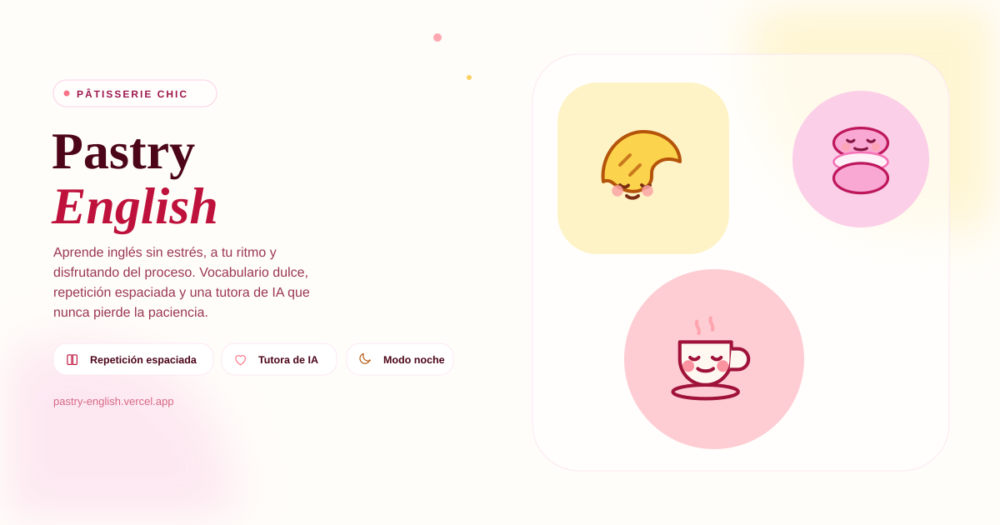

# 🥐 Pastry English • Pâtisserie Chic



> **Aprende inglés sin estrés, a tu ritmo y disfrutando del proceso.**

Pastry English es una aplicación web interactiva diseñada especialmente para personas que desean aprender inglés en un entorno cálido, acogedor y libre de ansiedad. Inspirada en la estética elegante de una pastelería francesa (*Pâtisserie Chic*), la plataforma combina métodos pedagógicos probados como la **Repetición Espaciada (SRS)** y el **Refuerzo Positivo**, eliminando contadores de tiempo estresantes, penalizaciones agresivas y métricas de presión.

---

## 🌟 Características Principales

### 1. 🗺️ La Ruta de los Caprichos Dulces (10 Niveles Progresivos)
- Un mapa interactivo con **10 niveles cuidadosamente graduados**, diseñados para aumentar el vocabulario de forma suave y sin saltos de dificultad bruscos.
- **Nivel 1:** El Despertar del Café (Saludos y Cortesía) — *Croissant de Mantequilla*
- **Nivel 2:** Aromas Cálidos y Antojos (Pedir en una cafetería) — *Macaron de Frambuesa*
- **Nivel 3:** Dulces Sensaciones (Sentimientos y Bienestar) — *Éclair de Chocolate*
- **Nivel 4:** Un Toque de Especias (Descripción y Gustos) — *Tarta Tatin de Manzana*
- **Nivel 5:** Celebración y Gratitud (Confianza e Intenciones) — *Tarta de Frutillas*
- **Nivel 6:** Pequeños Antojos y Horas Dulces (Tiempo y Elecciones) — *Muffin de Arándanos*
- **Nivel 7:** La Brisa del Jardín y Tiempo Libre (Clima y Paseos) — *Tartaleta de Frambuesa*
- **Nivel 8:** De Viaje y Nuevos Horizontes (Frases Viajeras) — *Cannoli Siciliano*
- **Nivel 9:** Palabras de Conexión y Amistad (Conectores y Charlas) — *Profiterol de Avellana*
- **Nivel 10:** Confianza, Sueños y Celebración (Metas y Cierre) — *Pavlova Etérea*

### 2. 🧁 Repaso Dulce (Sistema de Repetición Espaciada / SRS)
- Tarjetas interactivas con **efecto 3D Flip** para ejercitar la memoria de forma fluida y visual.
- Permite evaluar la retención mediante tres opciones sin presión:
  - **🌸 Repasar pronto:** Programa la tarjeta para el día siguiente.
  - **🧁 Bien:** Programa la tarjeta para dentro de 3 días.
  - **✨ ¡Dominado!:** Programa la tarjeta para 7 o más días.
- Algoritmo que calcula automáticamente las palabras pendientes del día sin acumulaciones abrumadoras.

### 3. 💬 Madame Amélie (Tutora de IA Empática)
- Integrada con la API de **Google Gemini** para ofrecer explicaciones personalizadas, trucos mnemotécnicos dulce y orientación fonética simplificada.
- Respuestas empáticas con tono maternal y cálido en español.

### 4. 📖 Cuaderno de Memoria (Glosario Interactivo)
- Biblioteca completa de vocabulario adquirido con buscador rápido, filtros por categoría (Saludos, Cafetería, Emociones, etc.) y reproductor de voz con velocidad ajustable.

### 5. 🍰 Vitrina de Pasteles y Logros del Corazón
- Galería donde se exhiben todas las recetas de repostería desbloqueadas al completar niveles.
- Sistema de insignia y logros (*Primer Paso Dulce*, *Mente Constante*, *Coleccionista de Azúcar*).

### 6. 🌙 Accesibilidad y Adaptación
- **Modo Luz Suave / Night Shift:** Filtro sepia cálido ideal para estudiar de noche o reducir la fatiga visual.
- **Modo Audio Lento:** Reproducción de audio a velocidad reducida mediante Web Speech API.
- **Diseño 100% Responsivo:** Interfaz adaptada para dispositivos móviles con navegación por pestañas deslizantes y zonas táctiles de fácil toque (mínimo 44px).

---

## 🎨 Visualización de la Interfaz y Flujo de Uso

### 📱 Estructura de la Aplicación

```
┌────────────────────────────────────────────────────────────────────────┐
│ 🥐 Pastry English    [🧁 15 Copas] [🌸 3d] [🌙 Modo Suave] [🔊 Lento] │
├────────────────────────────────────────────────────────────────────────┤
│ [ ☕ Ruta Pastelera ] [ ✨ Repaso Dulce (3) ] [ 📖 Cuaderno ] [ 🍰 Vitrina ] │
├────────────────────────────────────────────────────────────────────────┤
│                                                                        │
│   ┌────────────────────────────────────────────────────────────────┐   │
│   │ 🌸 Bienvenida a tu espacio seguro                              │   │
│   │ "Hoy tu cerebro aprende en paz, sin prisas ni presiones"       │   │
│   │ ─────────────                                                  │   │
│   │ 🔄 Tienes 3 palabras para tu Repaso Dulce hoy                 │   │
│   └────────────────────────────────────────────────────────────────┘   │
│                                                                        │
│   📍 Nivel 1: El Despertar del Café [Completado ✨]                   │
│   📍 Nivel 2: Aromas Cálidos y Antojos [ ¡Nivel Actual! 🧁 ]           │
│   🔒 Nivel 3: Dulces Sensaciones (Bloqueado)                           │
│                                                                        │
└────────────────────────────────────────────────────────────────────────┘
```

### 🃏 Tarjeta de Repaso 3D (SRS Flip Card)

```
        VISTA FRONTAL (Inglés)                   VISTA TRASERA (Español)
┌─────────────────────────────────────┐   ┌─────────────────────────────────────┐
│  [ Saludos ]                        │   │  [ Significado ]                    │
│                                     │   │                                     │
│            Thank you                │   │            Gracias                  │
│             🔊 (Audio)              │   │        /Zanc iu/ (Fonética)         │
│                                     │   │                                     │
│  🌸 Toca para girar la tarjeta      │   │  💡 Truco dulce mnemotécnico        │
└─────────────────────────────────────┘   └─────────────────────────────────────┘
                                                      │
                                   ┌──────────────────┴──────────────────┐
                                   │ [🌸 Repasar]  [🧁 Bien]  [✨ Dominado]│
                                   └─────────────────────────────────────┘
```

---

## 🛠️ Stack Tecnológico

- **Frontend:** React 18, TypeScript, Vite, Tailwind CSS v4.
- **Iconografía & Animaciones:** Lucide React, CSS 3D Transforms, Web Speech Synthesis API.
- **Backend & Servidor:** Node.js, Express (para proxy seguro de la API de Gemini).
- **IA / Tutor Virtual:** Google GenAI SDK (`@google/genai`) con el modelo `gemini-2.5-flash`.
- **Persistencia de Datos:** Client-Side Engine en `localStorage` (sin requerir registro ni base de datos externa).

---

## 🚀 Instalación y Ejecución Local

### Prerrequisitos
- **Node.js:** Versión 18.0 o superior.
- **npm** o **bun**.

### Pasos

1. **Clonar el repositorio:**
   ```bash
   git clone https://github.com/tu-usuario/pastry-english.git
   cd pastry-english
   ```

2. **Instalar dependencias:**
   ```bash
   npm install
   ```

3. **Configurar variables de entorno:**
   Crea o verifica el archivo `.env` en la raíz del proyecto agregando tu clave de API de Gemini:
   ```env
   GEMINI_API_KEY=tu_clave_gemini_aqui
   ```

4. **Iniciar el servidor de desarrollo:**
   ```bash
   npm run dev
   ```
   La aplicación estará disponible en `http://localhost:3000`.

5. **Compilar para producción:**
   ```bash
   npm run build
   npm start
   ```

---

## 📂 Estructura del Código

```
├── server.ts                    # Servidor Express con proxy para Gemini API y Vite
├── package.json                 # Dependencias y scripts de compilación
├── index.html                   # Entry point HTML
├── src/
│   ├── main.tsx                 # Montaje de React
│   ├── App.tsx                  # Componente principal y gestión de estado global
│   ├── index.css                # Estilos globales y utilidades Tailwind CSS v4
│   ├── types.ts                 # Interfaces TypeScript (Level, Vocab, SRS, UserProfile)
│   ├── data/
│   │   └── courses.ts           # Definición de los 10 niveles y logros
│   ├── utils/
│   │   ├── audio.ts             # Síntesis de voz (Web Speech API) y efectos de sonido
│   │   └── srs.ts               # Algoritmo de Repetición Espaciada (SuperMemo/SRS suave)
│   └── components/
│       ├── Header.tsx           # Barra superior y controles de accesibilidad
│       ├── BakeryMap.tsx        # Mapa de niveles y frase motivacional
│       ├── LessonModal.tsx      # Modal de aprendizaje interactivo por nivel
│       ├── SRSReviewModal.tsx   # Modal de Repaso Dulce con Flip Cards 3D
│       ├── MemoryNotebook.tsx   # Cuaderno de memoria y buscador de palabras
│       ├── PastryCabinet.tsx    # Vitrina de recetas desbloqueadas y logros
│       └── TutorChatModal.tsx   # Chat con Madame Amélie (IA de Gemini)
```

---

## 💡 Filosofía de Diseño: *Anxiety-Free Learning*

1. **Sin contadores de tiempo estresantes:** Las lecciones no imponen límites de segundos para responder.
2. **Sin pérdida de vidas ni penalizaciones:** Los errores no bloquean al usuario; se acompañan con explicaciones gentiles.
3. **Refuerzo Positivo Continuo:** Cada intento correcto se premia con *Copas de Azúcar* 🧁 y mensajes motivacionales.
4. **Diseño Visual Reconfortante:** Tonos crema, rosa suave y ámbar, inspirados en la estética de una repostería artesanal.

---

## 📄 Licencia

Este proyecto se distribuye bajo la licencia **MIT**. ¡Siéntete libre de utilizarlo, modificarlo y compartirlo con amor! 🌸🥐
